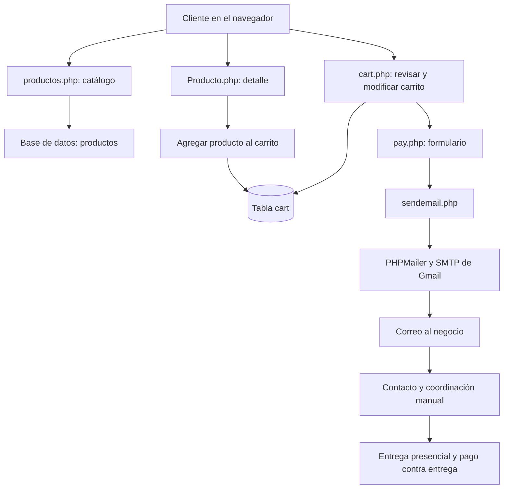

# SitioCarro — Catálogo de productos en PHP

Proyecto web desarrollado en **2022** como parte de mi proceso formativo de **Sistema Dual en una preparatoria técnica**, para una empresa local de mi comunidad.

> **Estado del proyecto:** MVP histórico e incompleto. Se conserva como muestra de mis primeros pasos con PHP y del aprendizaje obtenido durante el desarrollo. El código tiene limitaciones funcionales y de seguridad, por lo que no debe considerarse listo para producción.

## Sobre el proyecto

SitioCarro nació para ayudar a una empresa local a mostrar sus productos en un catálogo web y recibir solicitudes de compra por Internet. La idea era que el cliente pudiera explorar el catálogo, agregar productos a un carrito y enviar una solicitud al negocio. La entrega y el pago se coordinarían posteriormente de manera presencial, contra entrega; no se contemplaba una pasarela de pago electrónico.

Fue uno de mis primeros proyectos con **PHP puro**, realizado mientras todavía estaba aprendiendo desarrollo web. En su momento logré construir un MVP pequeño, sencillo y funcional para la necesidad inicial de la empresa, aunque no llegué a terminar el sistema. La versión de código que se conserva presenta defectos funcionales y limitaciones que no necesariamente reflejan cómo se comportaba en su entorno original. La implementación también refleja esa etapa de aprendizaje: tiene funcionalidades reales, pero incluye decisiones de diseño y prácticas que hoy abordaría de otra manera.

El proyecto formó parte de mi proceso de **Sistema Dual**, como recuerdo el nombre del programa durante la preparatoria técnica. En términos generales, la formación dual vincula la educación académica con el aprendizaje práctico en una empresa; no conservo las fechas exactas ni documentación suficiente para precisar la modalidad institucional en la que participé.

## Funcionalidades implementadas

Según el análisis del código disponible, el proyecto incluye:

- Catálogo de productos con paginación.
- Filtros por departamento y una búsqueda por descripción, con limitaciones.
- Página de detalle de producto con información e imágenes.
- Carrito de compras almacenado en una tabla de base de datos.
- Controles para incrementar o disminuir cantidades y eliminar productos.
- Formulario que solicita nombre, apellidos y teléfono.
- Intento de notificación al negocio por correo electrónico mediante SMTP y PHPMailer.
- Flujo de entrega y cobro presencial gestionado fuera de la aplicación.

La implementación conservada no constituye una tienda electrónica completa. No incluye pagos electrónicos, administración de pedidos, estados de envío, facturación ni seguimiento de entregas.

## Tecnologías

| Tecnología | Uso |
|---|---|
| PHP procedural | Procesamiento del lado del servidor y generación de páginas |
| MySQL/MariaDB mediante `mysqli` | Acceso a la base de datos; el motor exacto no está confirmado en el repositorio analizado |
| HTML | Estructura de las páginas |
| CSS | Estilos de la interfaz |
| JavaScript vanilla | Interacciones del navegador y construcción de partes de la interfaz |
| PHPMailer 5.2.23 | Biblioteca incluida en el proyecto para intentar enviar correos por SMTP |
| SMTP de Gmail | Transporte de correo configurado en el código |
| Ionicons 5.5.2 | Iconografía cargada desde CDN |

No se identificó un framework PHP ni un `composer.json` en la raíz de la aplicación. PHPMailer está incluido directamente dentro del repositorio y se carga mediante su archivo de autoload legado.

> **Versiones y compatibilidad:** la versión original de PHP y la versión exacta del motor de base de datos no están documentadas. La compatibilidad con versiones modernas de PHP no se ha verificado. PHPMailer 5.2.23 es una dependencia antigua.

## Arquitectura y organización

SitioCarro utiliza una estructura tradicional de múltiples páginas PHP con un enfoque principalmente procedural. Cada página concentra diferentes responsabilidades: consultas SQL, lógica del flujo, salida HTML y, en algunos casos, JavaScript. No se identificó una separación formal en capas ni un punto de entrada o enrutador único.

### Archivos principales

| Archivo o directorio | Responsabilidad observada |
|---|---|
| `productos.php` | Catálogo, filtros, búsqueda, paginación y acciones relacionadas con el carrito |
| `Producto.php` | Detalle de un producto y opción para agregarlo al carrito |
| `cart.php` | Consulta del carrito, modificación de cantidades, eliminación y cálculo del total |
| `pay.php` | Formulario de datos del cliente e inicio del proceso de envío del correo |
| `sendemail.php` | Función de envío mediante PHPMailer y SMTP |
| `CSS/` | Hojas de estilo de las páginas |
| `IMG/` | Logotipo, imágenes generales e imágenes de productos |
| `font/` | Tipografías locales |
| `PHPMailer/` | Biblioteca PHPMailer incluida con el proyecto |

El árbol anterior destaca las piezas principales; los archivos y recursos concretos deben consultarse en el repositorio.

### Patrones de diseño

El análisis no identificó patrones formales como MVC, Repository, Factory, Singleton o Front Controller en el código de la aplicación. La función `sendemail()` encapsula parte del envío del correo, pero corresponde a una función de utilidad y no demuestra, por sí sola, el uso de un patrón de diseño.

La estructura se describe mejor como una aplicación PHP procedural multipágina, con presentación, acceso a datos y parte de la lógica de negocio mezclados dentro de los mismos archivos.

## Flujo general



El diagrama representa el flujo que el código intenta implementar. No confirma que el envío de correo funcione actualmente ni que se complete una operación de compra de extremo a extremo.

## Datos y persistencia

El código consultado utiliza una base de datos denominada `productosaccess`. No se encontró un volcado SQL ni un esquema oficial de la base de datos, de modo que las tablas y columnas siguientes se infieren a partir de las consultas observadas.

### Tabla `productos` — estructura inferida

| Campo | Uso observado |
|---|---|
| `id_producto` | Identificador del producto |
| `codigo` | Código utilizado para localizar la carpeta de imágenes |
| `descripcion` | Descripción que aparece en el catálogo y se utiliza en la búsqueda |
| `departamento` | Categoría o departamento del producto |
| `precio` | Precio unitario |
| `cantidad` | Existencias del producto |

### Tabla `cart` — estructura inferida

| Campo | Uso observado |
|---|---|
| `cart_id` | Identificador de la fila del carrito |
| `producto_id` | Referencia al producto |
| `cantidad` | Unidades seleccionadas |

El carrito no incluye identificador de usuario ni de sesión. Según las consultas revisadas, sus registros se leen de manera global, por lo que los visitantes pueden terminar compartiendo el mismo carrito. Tampoco se identificó una tabla que conserve los pedidos enviados: el correo funciona como notificación, no como registro persistente de una venta.

## Limitaciones conocidas

Los siguientes puntos proceden del análisis estático realizado con Open Code. No se ejecutó la aplicación durante ese análisis, de modo que el comportamiento real en ejecución no se ha validado independientemente.

### Limitaciones funcionales

- El formulario solicita nombre, apellidos y teléfono, pero no contiene un campo de dirección de entrega ni un campo de correo electrónico.
- El código intenta leer `customer_email`, aunque ese campo no aparece en el formulario.
- Los apellidos se reciben, pero no se incorporan al correo descrito por el análisis.
- La plantilla `email_template.html` referenciada por el código no se encuentra en el repositorio analizado y el parámetro correspondiente no se utiliza en la función de envío.
- No se registra el pedido en una tabla independiente y el carrito no se vacía automáticamente después de enviar el correo.
- La cantidad elegida en la ficha del producto no parece formar parte de la solicitud de agregar al carrito.
- La búsqueda usa una expresión equivalente a `LIKE '%texto'`; al no tener `%` al final, no implementa una búsqueda parcial general y puede devolver resultados distintos de los esperados.
- Hay referencias a `index.html`, aunque ese archivo no aparece en la estructura analizada.
- Se identificaron problemas en el orden de salida HTML y redirección, y diferencias entre los datos mostrados y los que procesa el servidor.

### Seguridad y mantenimiento

El análisis también reporta problemas que impedirían recomendar una puesta en producción sin cambios importantes:

- Consultas SQL construidas mediante concatenación de parámetros recibidos por HTTP.
- Validaciones principalmente del lado del navegador, sin validación equivalente suficiente en el servidor.
- Salida de datos en HTML y JavaScript sin escape consistente.
- Ausencia de protección CSRF identificada en las acciones revisadas.
- Configuración de conexión a base de datos y credenciales SMTP incrustadas en el código.
- Ausencia de controles de errores consistentes para conexiones y consultas.
- Dependencia antigua de PHPMailer.
- Carrito compartido entre visitantes por falta de aislamiento por usuario o sesión.

Estos hallazgos se incluyen para dejar constancia del estado técnico del proyecto, no como afirmación de que el sistema sea seguro o de que todas las vulnerabilidades se hayan comprobado mediante pruebas dinámicas.

> **Antes de publicar el repositorio:** comprueba que no haya contraseñas, credenciales SMTP, claves o datos personales reales. Si alguna credencial estuvo expuesta en un repositorio público, revócala o cámbiala; borrar el valor del archivo actual no lo elimina necesariamente del historial de Git.

## Instalación y ejecución local

La ejecución reproducible no está garantizada con los archivos documentados: no se identificó un volcado SQL ni un esquema original de base de datos, y la configuración está incrustada en distintos archivos PHP. Las instrucciones siguientes son orientativas para explorar una copia local, no una receta para desplegar el sistema en producción.

### Requisitos identificados

- PHP con la extensión `mysqli`.
- Una base de datos compatible con `mysqli` y con la estructura que espera el código.
- Extensión `openssl` y conectividad de red si se intenta el envío SMTP con TLS.
- Un entorno local de desarrollo. No se recomienda exponer esta aplicación legada directamente a Internet.

### Arrancar el servidor de desarrollo de PHP

Desde la raíz del proyecto, con PHP instalado:

```bash
php -S 127.0.0.1:8000
```

Abre el catálogo usando la ruta y los parámetros que espera la aplicación:

```text
http://127.0.0.1:8000/productos.php?c1=4&c2=5&page=1
```

Para ver productos correctamente también necesitas configurar una base de datos con los datos requeridos y asegurarte de que las rutas a imágenes existan. El repositorio analizado no incluye un esquema SQL original ni un conjunto de datos con el que reproducir la aplicación directamente.

**No ejecutes este proyecto con datos reales ni habilites el envío de correos antes de revisar y corregir la configuración, las credenciales y las validaciones.** La ausencia de `customer_email` y otros defectos identificados hacen que el flujo de correo actual sea poco fiable.

## Pruebas manuales sugeridas

Una vez preparado un entorno local aislado y una base de datos compatible, se puede revisar:

1. Que el catálogo se muestre y consulte productos.
2. Que los filtros, la búsqueda y la paginación respondan como se espera.
3. Que las fichas muestren la información e imágenes correspondientes.
4. Que agregar, modificar y eliminar productos afecte al carrito de la forma prevista.
5. Que el formulario rechace datos inválidos también en el servidor; el código existente no ofrece esa validación suficiente.
6. Que el envío SMTP se gestione correctamente después de corregir el campo de correo y revisar las credenciales.
7. Que un pedido quede registrado de manera persistente si se decide completar esa funcionalidad en una futura versión.

Estas son comprobaciones propuestas; no significa que se hayan ejecutado ni superado. El análisis de Open Code fue estático y no incluyó pruebas en ejecución.

## Aprendizajes y valor del proyecto

Aunque no llegué a terminarlo, SitioCarro fue una experiencia importante en mi formación porque me permitió poner en práctica varios fundamentos de desarrollo web:

- Construcción de páginas dinámicas con PHP.
- Consultas SQL y conexión entre la aplicación y una base de datos.
- Uso de HTML, CSS y JavaScript para crear la interfaz.
- Implementación de un catálogo, fichas de productos y un carrito.
- Integración de una biblioteca externa para el envío de correos.
- Comprensión de un flujo de negocio sencillo que combina una solicitud digital con una entrega presencial.

Al revisar el código tiempo después, también se hacen visibles aspectos que hoy abordaría de otra manera: separar responsabilidades, validar las entradas en el servidor, usar consultas preparadas, escapar la salida, aislar el carrito por usuario o sesión, sacar los secretos de la aplicación y registrar los pedidos de forma persistente.

## Estado actual y alcance

SitioCarro se presenta como un **proyecto histórico de aprendizaje**, no como un producto mantenido ni como un sistema listo para producción. La documentación refleja el análisis estático disponible; no se ha confirmado la versión original de PHP, el esquema completo de la base de datos ni el funcionamiento actual del envío de correo.

El valor principal del proyecto es representar una etapa temprana de mi formación como desarrollador y mostrar cómo abordé una necesidad real de una empresa local mientras aprendía PHP.
